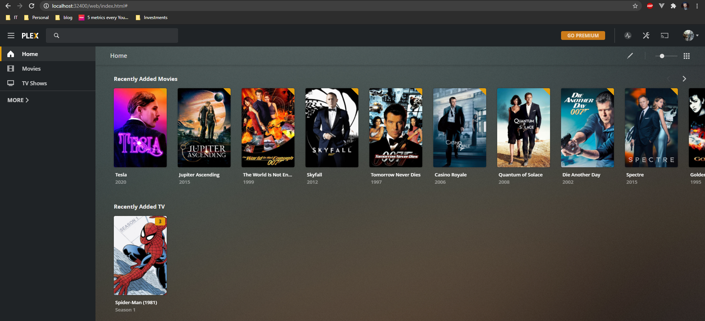

# Plex

Plex is a home media server that allows mounting movies/tvshows and then serving them on any device in the home network (or even outside).

## Getting Started

```
docker-compose up
```

#### Settings

|variable|purpose|
|---|---|
|PLEX_MOVIES_DIR|path to the directory to mount with your movies|
|PLEX_TVSHOWS_DIR|path to the directory to mount with your TV shows|
|PLEX_ALLOWED_NETWORKS|`allowedNetworks` pref: comma-separated CIDRs allowed without Plex sign-in|
|PLEX_CUSTOM_CONNECTIONS|`customConnections` pref: comma-separated URLs advertised to clients|
|PLEX_FRIENDLY_NAME|`FriendlyName` pref: server name shown in clients|

Any `PLEX_PREF_<name>` variable on the container is written into Preferences.xml on every start, so prefs set here win over the Plex UI. Restart the container after the first start, since Preferences.xml doesn't exist until then.

## Outcome
